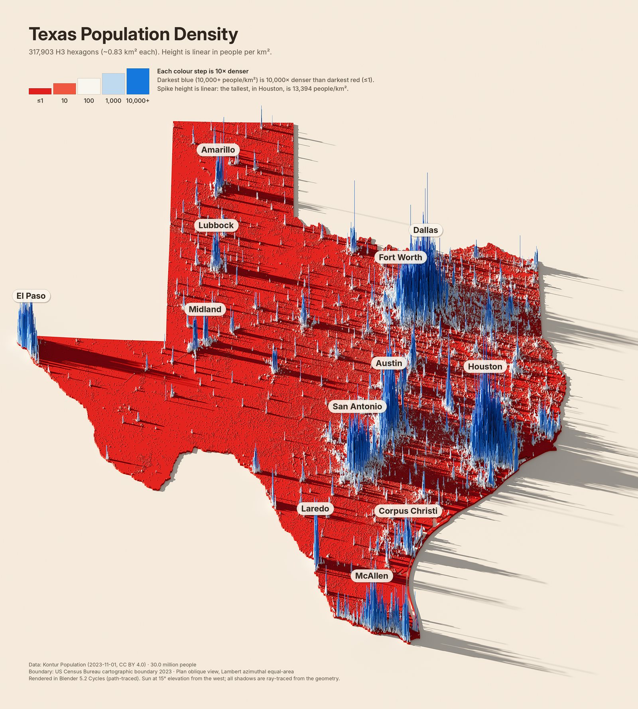
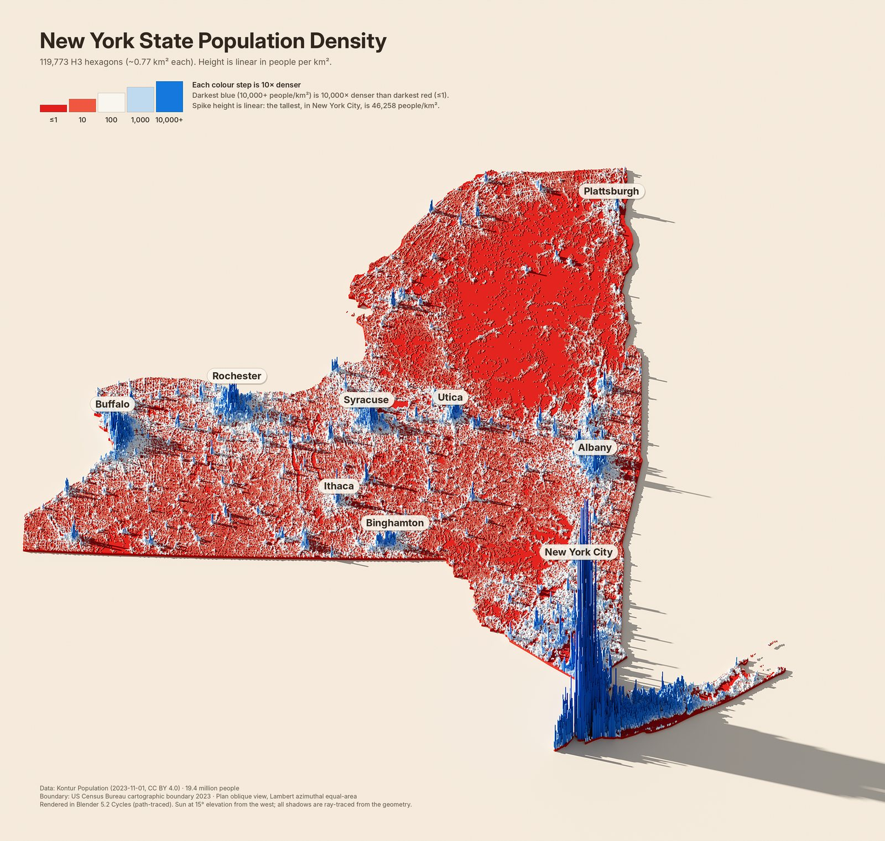
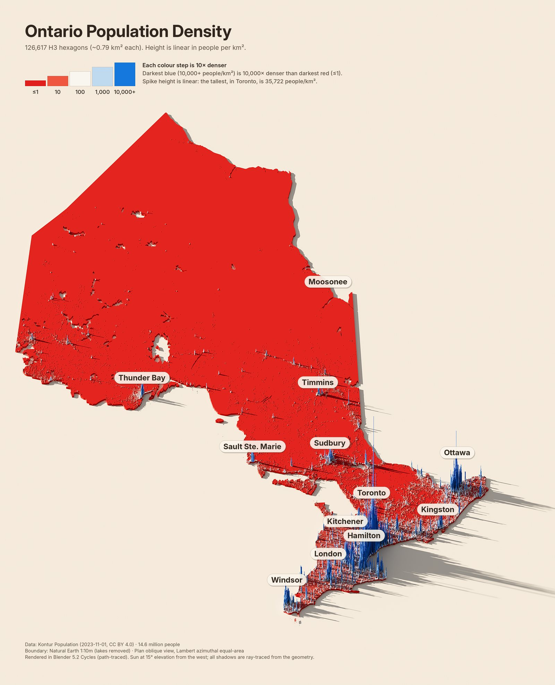
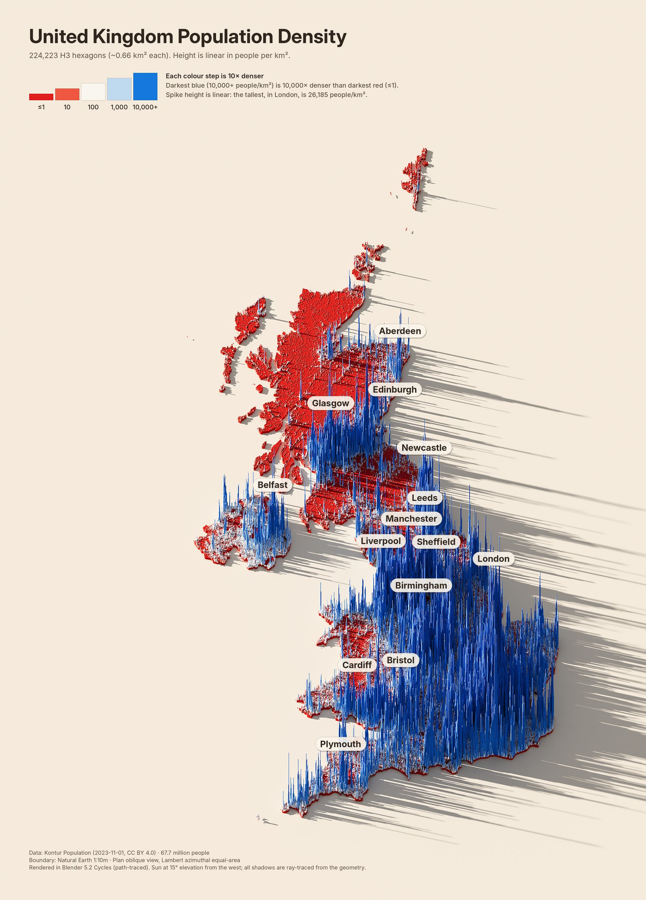
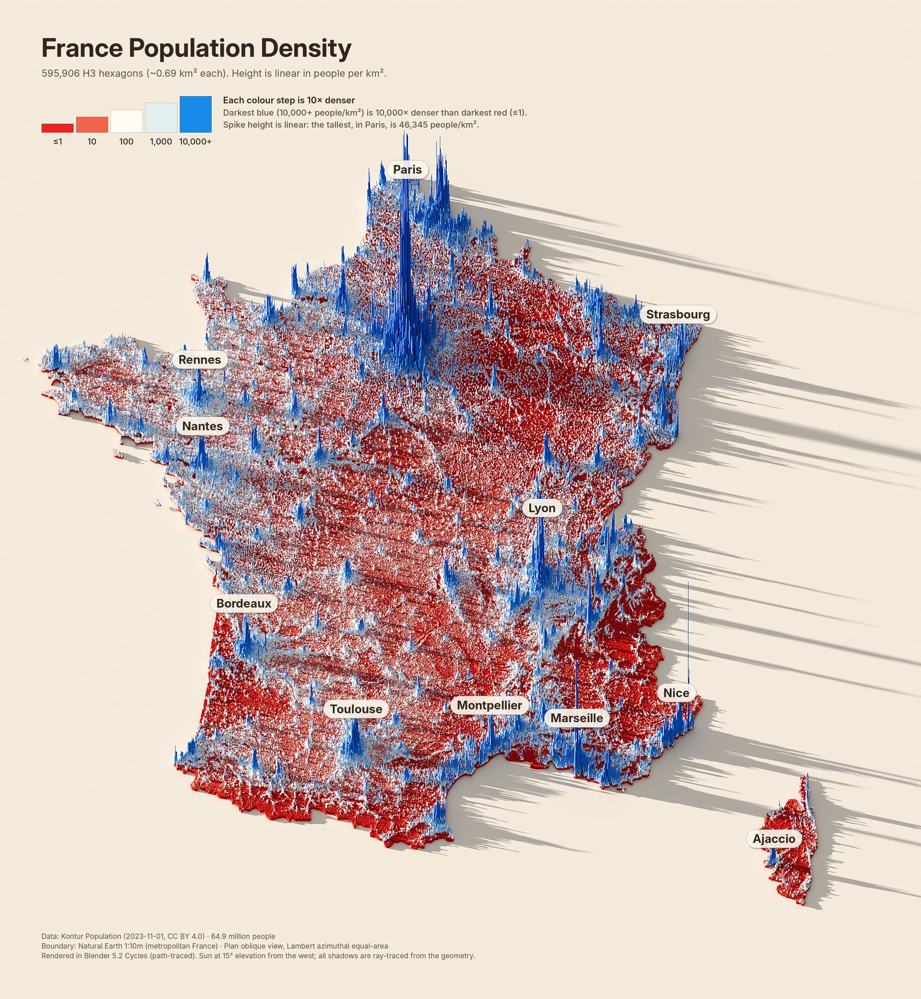
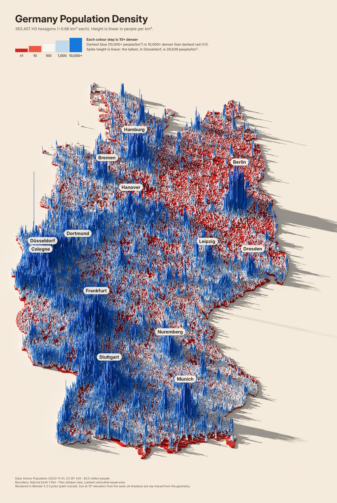
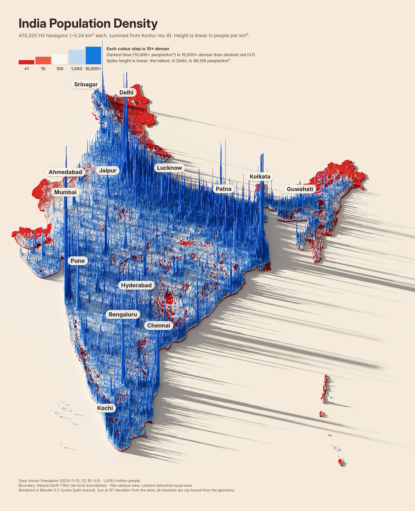
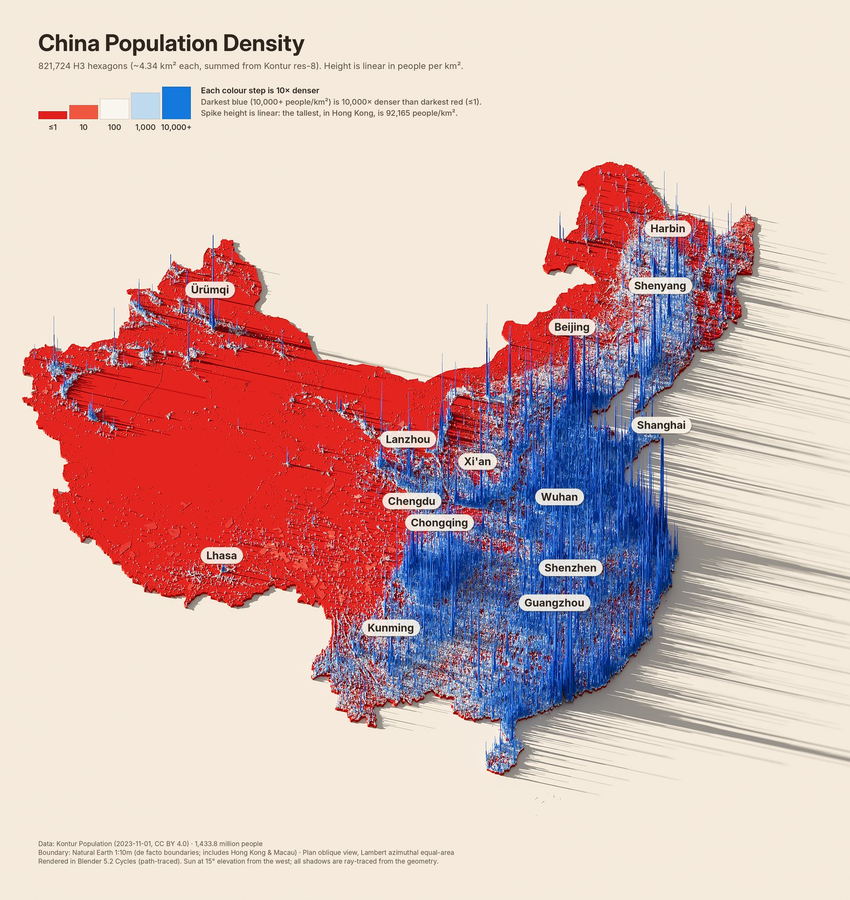
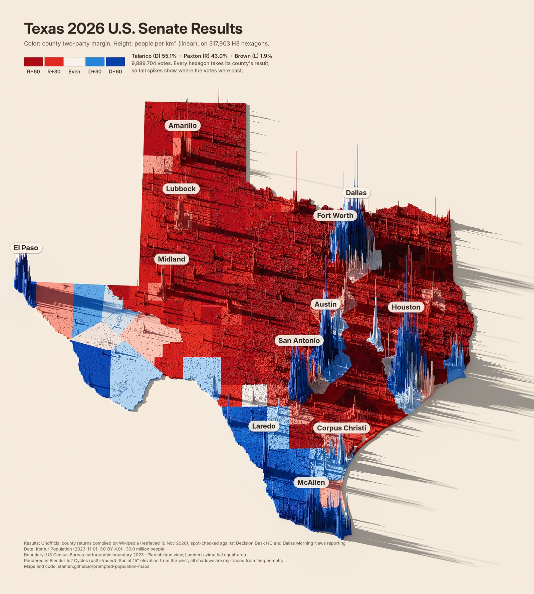
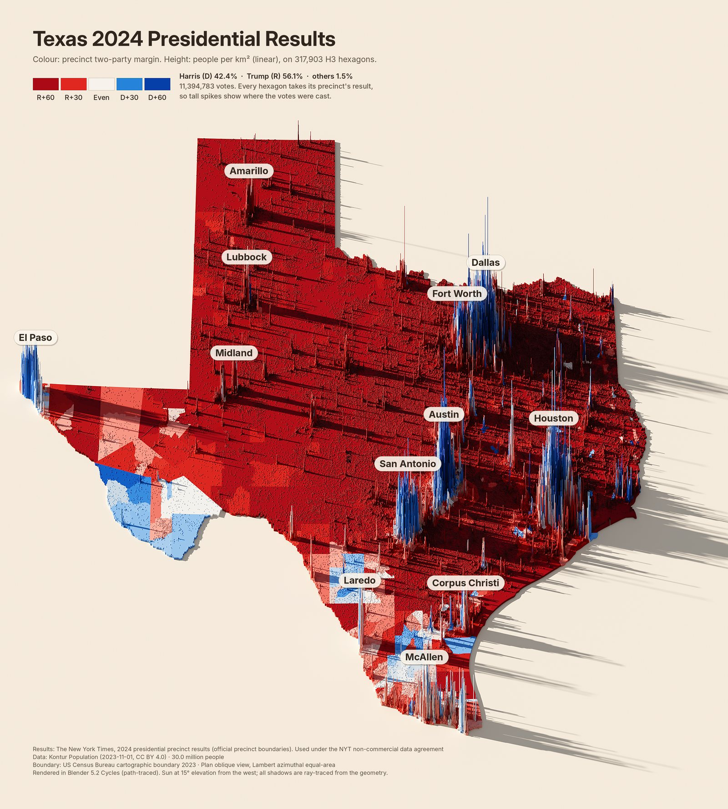

# Prompted Population Maps

Path-traced 3D population maps. Every inhabited [H3](https://h3geo.org) hexagon from
[Kontur Population](https://www.kontur.io/portfolio/population-dataset/) is extruded to a height that is linear in
people per km², then rendered in Blender Cycles under a low sun, so every shadow is ray-traced from the real geometry.
The same spikes can be coloured by density or by election results.

**Site:** https://stamen.github.io/prompted-population-maps/ (gallery, the step-by-step history, and the code)



The whole project was made by prompting an AI coding agent, one conversation from the first Texas render to this
repo. [`AGENTS.md`](AGENTS.md) is written so that you can hand the repo to your own agent and keep going.

## Maps

<table>
<tr><td align="center"><a href="docs/full/texas.jpg"></a><br>Texas</td><td align="center"><a href="docs/full/new_york.jpg"></a><br>New York State</td><td align="center"><a href="docs/full/ontario.jpg"></a><br>Ontario</td></tr>
<tr><td align="center"><a href="docs/full/uk.jpg"></a><br>United Kingdom</td><td align="center"><a href="docs/full/france.jpg"></a><br>France</td><td align="center"><a href="docs/full/germany.jpg"></a><br>Germany</td></tr>
<tr><td align="center"><a href="docs/full/india.jpg"></a><br>India</td><td align="center"><a href="docs/full/china.jpg"></a><br>China</td><td align="center"><a href="docs/full/texas_senate.jpg"></a><br>Texas 2026 Senate (county)</td></tr>
<tr><td align="center"><a href="docs/full/texas_pres2024.jpg"></a><br>Texas 2024 presidential (precinct)</td></tr>
</table>

Full-resolution JPEGs are in [`docs/full/`](docs/full).

## Quick start

```bash
git clone https://github.com/stamen/prompted-population-maps && cd prompted-population-maps
uv venv -p 3.13 renv && uv pip install -p renv/bin/python -r requirements.txt   # Blender comes in as the bpy module
export PYTHON=renv/bin/python
pipeline/fetch_data.sh US DE                 # Kontur files by ISO-2 code, plus boundaries
pipeline/make_map.sh germany preview         # ~30 s  -> out/germany_preview.png
pipeline/make_map.sh germany final           # 6-15 min on 4 CPU cores -> out/germany.png
```

Election maps need `pipeline/fetch_data.sh --elections` first, then `pipeline/make_map.sh texas_senate final`.

### Using an LLM agent

Give your agent something like:

> Clone https://github.com/stamen/prompted-population-maps and read AGENTS.md. Set up the environment, then make a
> population density map of Japan in the same style: add a region entry, render a preview, show it to me, and check
> the population total against the official figure before rendering the final.

`AGENTS.md` covers the commands, the repo map, how to add regions and election data, the invariants (real data
only, linear heights, rendered legends, ray-traced shadows, source credits) and the pitfalls that were already solved.
`CLAUDE.md` imports it for Claude Code.

## How it works

1. **`prep.py`** clips Kontur cells to a boundary, sums cells to H3 resolution 7 for regions wider than 2,000 km,
   projects to Lambert azimuthal equal-area, and for election maps joins each cell to its county or precinct.
2. **`render.py`** builds a Blender scene: one hexagonal prism per cell (2–6 million faces), a land slab, a ground
   plane, a sun at 15° (`SUN_EL` in `regions.py`) and a faint sky fill. The camera is a 50° orthographic oblique
   view rendered with wide pixels (`1/cos 50°`), a *plan oblique* projection that keeps the true top-down footprint
   while heights rise. Cycles path-traces at 64 samples with denoising.
3. **`legend_render.py`** renders the legend swatches as flat tiles under the same lighting, so they match the map.
4. **`annotate.py`** applies a colour grade (white point measured from the bare ground), then the title,
   stepped legend, callouts, credits and city labels.

## Data and licences

| Source | Used for | Licence |
|---|---|---|
| [Kontur Population 2023-11-01](https://data.humdata.org/organization/kontur) | population per H3 cell | CC BY 4.0 |
| [Natural Earth 1:10m](https://www.naturalearthdata.com) | country, province and lake boundaries | public domain |
| [US Census cartographic boundaries 2023](https://www.census.gov/geographies/mapping-files/time-series/geo/cartographic-boundary.html) | US states and counties | public domain |
| [Wikipedia: 2026 U.S. Senate election in Texas](https://en.wikipedia.org/wiki/2026_United_States_Senate_election_in_Texas) | unofficial county returns | CC BY-SA 4.0 |
| [NYT 2024 presidential precinct map](https://github.com/nytimes/presidential-precinct-map-2024) | Texas precinct results and boundaries | NYT non-commercial; credit required |
| [Inter](https://github.com/rsms/inter) | map typography (`fonts/`) | SIL OFL 1.1 |

Code is MIT licensed (see `LICENSE`). Boundaries follow Natural Earth's de facto lines, and China includes Hong Kong and Macau.
The 2026 Senate figures were unofficial at the time of rendering; swap in the certified canvass when it is published.

## What it cost

See the *What it took* section of the site for measured session totals (tokens and API cost) and an estimated
split by phase. The short version: the first Texas map took about a third of the session; once the pipeline was
general, each new region cost about 2k new tokens and 6–15 minutes of rendering.

## Rebuilding the site

`docs/` is served by GitHub Pages (Settings → Pages → Deploy from branch → `main` / `/docs`).
After rendering finals into `out/`, run `python docs/build_site.py`: it exports web and full-size JPEGs, fills
`docs/template.html` with the gallery, history (`docs/history.json`), cost log (`docs/cost_log.json`) and the
current pipeline source, and writes `docs/index.html`.
